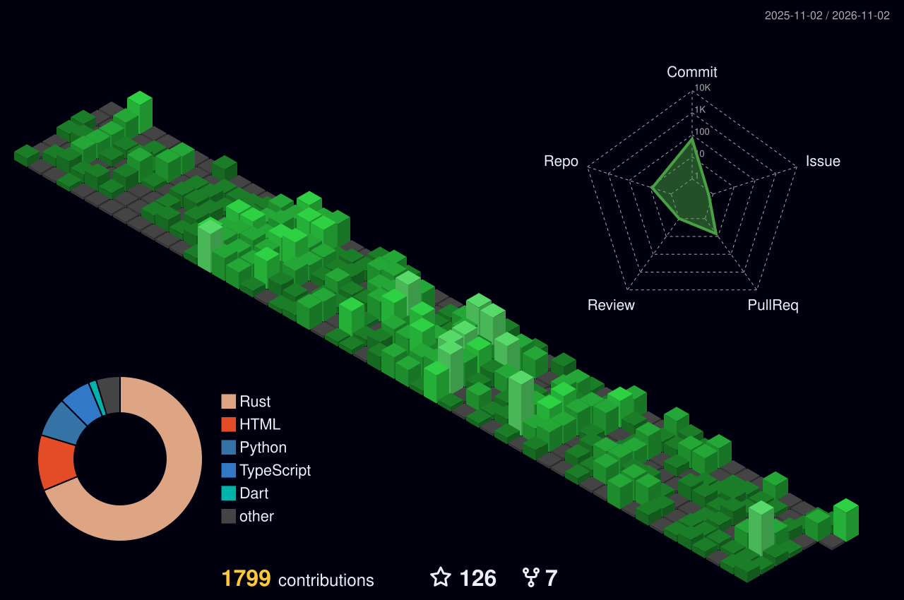

# Jiří Klimeš

I study machine intelligence through discrete search over learned world models, and build Rust systems for low-latency and local workloads.

- [LightSearch](https://klimes.dev/writing/light-search): trained to depth 3, it finds depth-9 programs in a billion-program space while expanding under 0.04% of it.
- Avenance: People do the hard work of finding answers; LLMs learn to guess from the results. Avenance is built to do the finding itself.
- [tachyx](https://github.com/JirkaKlimes/tachyx): remote desktop with QUIC, congestion control, and GPU H.264/AV1 encoding.
- [belay](https://github.com/JirkaKlimes/belay): a default-deny agent sandbox with a VM escape test suite.
- [scry](https://github.com/JirkaKlimes/scry): local image search and OCR in a static Rust binary.

